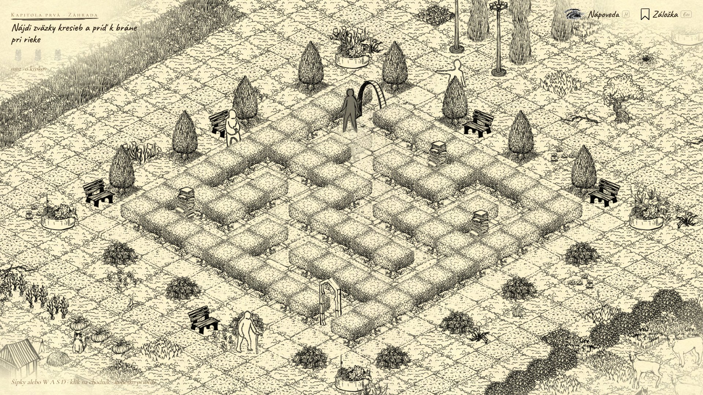

# Záhrada stratených ciest (Garden of Lost Paths)

An isometric storybook maze game built with **Phaser 4** and **rot.js** procedural maze generation.



## Overview

**Záhrada stratených ciest** (*Garden of Lost Paths*) is an interactive isometric adventure told through the pages of an illustrated book. The player navigates a procedurally generated riverside garden maze to reach Grandmother Elena while collecting three lost sketchbooks along the way. The world features dynamic weather (rain, clear skies, flowing water), animated villagers and animals, voice acting, and an A* pathfinding hint/autopilot system.

## Architecture & Features

- **Procedural Maze & Pathfinding (`Olym_PG1_20262027/js/maze.js`)**: Uses `rot.js` (`ROT.Map.IceyMaze`) to generate solvable garden mazes and `ROT.Path.AStar` for path guidance and solution playback.
- **Isometric Projection & Depth Sorting (`js/iso.js`, `js/scenes/WorldScene.js`)**: Custom 2:1 isometric coordinate projection, camera zoom/pan, and dynamic painter's-algorithm depth sorting across terrain tiles, hedges, characters, and weather particles.
- **Interactive Storybook UI (`js/book.js`, `js/story.js`, `js/cinema.js`)**: Animated page-turning prologue/epilogue sequences, margin bookmarks, and handwritten journal overlays.
- **Audio & Voice Direction (`js/sound.js`, `nastroje/hlasy.py`)**: Spatial ambient soundscapes (rain, stream, footsteps, piano) and synchronized Slovak voiceover narration.
- **Asset Pipeline (`nastroje/`)**: Node.js and Python build scripts (`atlas.js`, `ui-textury.js`, `balik.py`) for packing spritesheets and generating book textures.

## Controls

| Action | Input |
| --- | --- |
| Open book / Continue | Click, `Enter`, or `Space` |
| Move character | Arrow keys, `WASD`, or click on a path tile |
| Zoom camera | Mouse wheel |
| Bookmark menu / Pause | `Esc` |
| Show hint | `H` |
| Auto-walk solution | `U` |
| Toggle fullscreen | `F` |

## Running Locally

All libraries (`phaser.min.js`, `rot.min.js`), fonts, textures, and audio assets are bundled locally—no internet connection or package installation is required to play:

```sh
python -m http.server 8137 --bind 127.0.0.1 --directory Olym_PG1_20262027
```

Then open `http://localhost:8137/` in any WebGL-capable browser.

## Repository Structure

```text
Olym_PG1_20262027/   Playable game bundle (HTML, CSS, JS scenes, textures, audio, fonts)
dokumentacia/        LaTeX documentation sources, PlantUML architecture diagrams, screenshots
nastroje/            Sprite atlas packer, UI texture generator, and packaging scripts
```

## License

Code is released under the [MIT License](LICENSE). Third-party art, font, and audio attributions are documented in [`Olym_PG1_20262027/licencie.txt`](Olym_PG1_20262027/licencie.txt).
